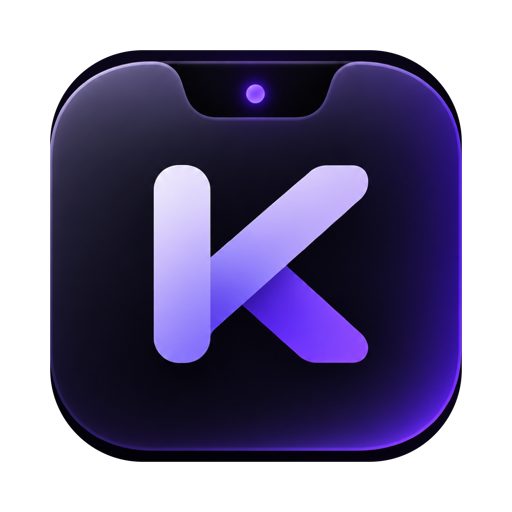

<p align="center">
  
</p>

<h1 align="center">Notchkse</h1>

<p align="center">
  Transforma o notch do MacBook num hub vivo: música, bandeja de arquivos, clipboard,
  prompt de IA, medidores do sistema e avisos — com animações nativas e consumo mínimo.
</p>

---

## Funcionalidades

Tudo é modular: cada item pode ser ligado ou desligado nos Ajustes, e módulo desligado não gasta nada.

**Nook (aba inicial)**
- **Música** (Spotify e Apple Music): capa, controles, barra de progresso arrastável e visualizador
- **Letra sincronizada**: a linha atual da música em tempo real (via [LRCLIB](https://lrclib.net))
- **Calendário**: próximos eventos e botão para entrar na reunião (Meet, Zoom, Teams…)
- **Atalhos**: rode seus Atalhos favoritos do app Atalhos
- **Espelho**: prévia da câmera antes de uma call

**Bandeja**
- Arraste arquivos até o notch para guardá-los e arraste de volta para qualquer app
- **AirDrop**: solte arquivos para enviar
- **Prateleira de capturas**: capturas de tela entram sozinhas na bandeja

**Produtividade**
- **Clipboard**: os 10 últimos itens copiados (ignora gerenciadores de senha)
- **Prompt de IA**: pergunte ao Claude Code, Codex, Gemini CLI, OpenCode, Cursor Agent ou Ollama instalados

**Sistema**
- **Medidores de CPU, GPU e RAM** no topo do notch aberto
- Avisos ao conectar o **carregador** e **dispositivos Bluetooth** (com bateria de AirPods etc.)
- **Progresso de downloads** e aviso de download concluído

**Notch fechado**
- Live activities: capa + visualizador, carregamento, dispositivo conectado, download, captura salva, resposta da IA
- **Não cobre os menus dos apps**: mede o espaço livre na barra de menus e se encaixa nele
  (tamanho completo, compacto ou pontos pulsando), com animação ao trocar de app

**Interação e aparência**
- Abre ao passar o mouse, clicando ou deslizando dois dedos para baixo; desliza para os lados para trocar de música
- Animações com mola, entrada em cascata e vibração no trackpad
- Tema preto e branco, com efeito de vidro (blur) configurável
- Sempre na tela do MacBook (some com a tampa fechada)

## Desempenho

O Notchkse é orientado a eventos: com o notch fechado, nada fica rodando em loop.
Medido em Apple Silicon (versão release, ocioso): **~18 MB de memória e ~0% de CPU**.

- Música via notificações do Spotify/Music (sem polling)
- Medidores de CPU/GPU/RAM só leem com o notch aberto
- Capas e capturas decodificadas já em tamanho reduzido
- A câmera só liga quando o espelho está visível

## Requisitos

- macOS 14 ou superior (testado no macOS 27)
- MacBook com notch (em Macs sem notch ele desenha um notch virtual)
- Xcode 26+ para compilar

## Instalação (compilando)

```bash
git clone https://github.com/cauakse/Notchkse.git
cd Notchkse

# Opcional, mas recomendado: certificado local para as permissões do macOS
# continuarem valendo entre builds (cria "Notchkse Local Signing" no Keychain)
./scripts/setup-signing.sh

# Compila em Release e instala em /Applications
./scripts/install.sh
```

Ou abra `Notchkse.xcodeproj` no Xcode e rode o target **Notchkse**.

## Permissões

Cada permissão só é pedida quando o módulo correspondente está ligado:

| Permissão | Para quê |
|---|---|
| Automação (Spotify / Music) | Ler a faixa atual e controlar a reprodução |
| Controle do Dispositivo (Acessibilidade) | Ler a posição dos menus para não cobri-los |
| Bluetooth | Avisar quando um dispositivo conecta |
| Pasta Downloads | Progresso de downloads |
| Câmera | Espelho |
| Calendário | Próximos eventos |

## Privacidade

Nada é enviado para servidores do Notchkse — não existe servidor. As únicas chamadas de rede são:
- **LRCLIB**, com título/artista/álbum da música atual, para buscar a letra (desligue o módulo para evitar)
- O **agente de IA que você escolher**, executado localmente pela CLI dele

O histórico do clipboard fica só na memória (imagens em cache local) e é apagado ao desligar o módulo.

## Estrutura

```
Notchkse/
├── App/        # Entrada do app e coordenador dos módulos
├── Core/       # Janela do notch, formato, animações, ajustes, barra de menus
├── Modules/    # Serviços: música, letra, clipboard, IA, bateria, Bluetooth…
└── Views/      # SwiftUI: notch fechado/aberto, abas, ajustes
```

## Licença

[MIT](LICENSE) — use, modifique e distribua à vontade.
